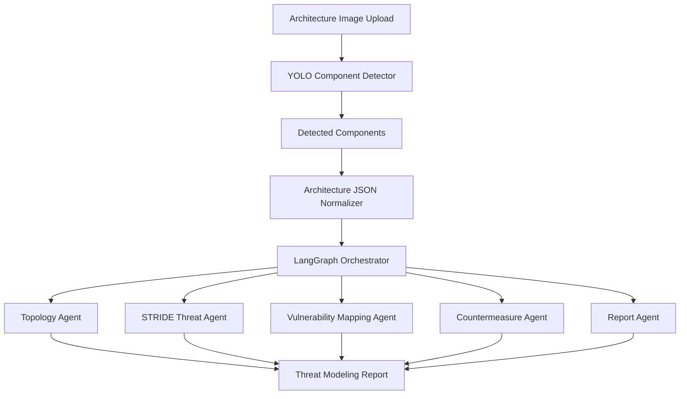
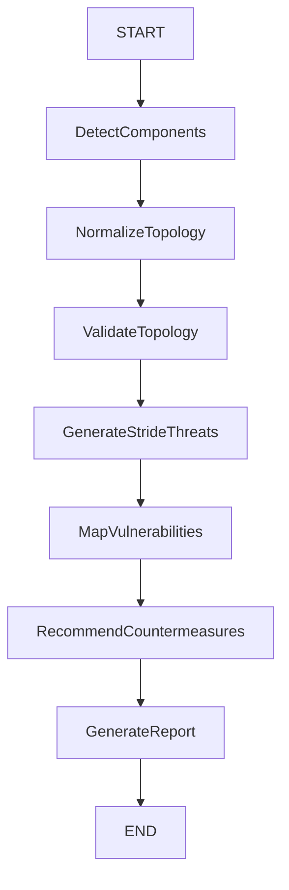

# AGENTS.md

## Project: ThreatGraph AI

ThreatGraph AI is a hackathon MVP for automated threat modeling from software architecture diagrams.

The system receives an architecture diagram as an image, detects architectural components using a supervised object detection model, converts the detection result into a structured architecture representation, and uses a LangGraph-based multi-agent workflow to generate a STRIDE threat modeling report with vulnerabilities, risks, confidence levels, and recommended countermeasures.

---

## Main Goal

Build an AI-powered system capable of:

1. Reading a software architecture diagram from an image.
2. Detecting architecture components such as users, APIs, gateways, WAFs, databases, services, caches, storages, identity providers, monitoring services, and network boundaries.
3. Using a supervised model trained on an annotated dataset.
4. Converting detections into a structured JSON architecture model.
5. Applying STRIDE threat modeling.
6. Mapping threats to vulnerabilities and security countermeasures.
7. Generating a technical and executive cybersecurity report.

The system must not rely only on LLM visual interpretation. The supervised component detection model is part of the core MVP.

---

## High-Level Architecture



---

## Repository Structure

Expected structure:

```text
/threatgraph-ai
  /backend
    /app
      main.py
      config.py
      schemas.py
      graph.py
      services/
        detector_service.py
        topology_service.py
        report_service.py
        vulnerability_service.py
      agents/
        topology_agent.py
        stride_agent.py
        vulnerability_agent.py
        countermeasure_agent.py
        report_agent.py
      data/
        vulnerability_knowledge_base.yaml
        stride_rules.yaml
    requirements.txt

  /frontend
    /src
      App.tsx
      components/
      pages/
      services/
    package.json

  /notebooks
    01_train_architecture_component_detector_yolo_colab.ipynb

  /models
    README.md
    best.pt

  /docs
    architecture.md
    training.md
    methodology_stride.md
    demo_script.md

  AGENTS.md
  README.md
```

---

## Core Agents

### 1. Topology Agent

Responsible for transforming raw detection results into a structured architecture model.

Input:

```json
{
  "detected_components": [
    {
      "component_type": "edge_waf",
      "confidence": 0.91,
      "bbox": {
        "x1": 123,
        "y1": 55,
        "x2": 221,
        "y2": 143
      }
    }
  ]
}
```

Output:

```json
{
  "components": [
    {
      "id": "component_001",
      "type": "edge_waf",
      "name": "WAF",
      "zone": "edge",
      "exposure": "internet-facing",
      "confidence": 0.91
    }
  ],
  "flows": [],
  "trust_boundaries": []
}
```

Responsibilities:

* Normalize detected classes.
* Group related components.
* Infer possible zones such as internet, edge, public subnet, private subnet, data zone, and external services.
* Identify missing information.
* Mark inferred data with confidence levels.
* Never treat inferred topology as confirmed fact.

Rules:

* Always preserve detector confidence.
* Add `needs_human_validation: true` when the architecture relation is unclear.
* Do not invent components that were not detected or provided by the user.
* Do not assume security controls unless explicitly detected or provided as context.

---

### 2. STRIDE Threat Agent

Responsible for applying STRIDE to each component and flow.

STRIDE categories:

* Spoofing
* Tampering
* Repudiation
* Information Disclosure
* Denial of Service
* Elevation of Privilege

Input:

```json
{
  "components": [
    {
      "id": "api_gateway_001",
      "type": "edge_gateway",
      "exposure": "internet-facing"
    }
  ],
  "flows": [
    {
      "source": "external_user",
      "target": "api_gateway_001",
      "protocol": "HTTPS"
    }
  ]
}
```

Output:

```json
{
  "threats": [
    {
      "id": "T001",
      "component_id": "api_gateway_001",
      "stride_category": "Denial of Service",
      "description": "Public API gateway may be exposed to traffic spikes or abuse if rate limiting is not configured.",
      "severity": "High",
      "confidence": "Medium",
      "evidence": "API gateway appears to be internet-facing.",
      "needs_validation": [
        "Confirm whether rate limiting is enabled.",
        "Confirm whether WAF rules are active.",
        "Confirm whether API quotas are configured."
      ]
    }
  ]
}
```

Rules:

* Every threat must be mapped to one STRIDE category.
* Every threat must include evidence.
* Every threat must include confidence.
* Every threat must include at least one validation question when confidence is not high.
* Do not claim a real vulnerability without evidence.
* Prefer wording such as "potential risk", "possible exposure", or "requires validation" when based only on the diagram.

---

### 3. Vulnerability Mapping Agent

Responsible for mapping threats to likely vulnerabilities and weakness patterns.

Sources:

* Local YAML knowledge base.
* OWASP-style application security categories.
* API security risks.
* Cloud architecture security practices.
* Internal project rules.

Example mapping:

```yaml
edge_gateway:
  Denial of Service:
    vulnerabilities:
      - Missing rate limiting
      - Missing API quota
      - Missing bot protection
    countermeasures:
      - Enable rate limiting
      - Configure API quotas
      - Add WAF/bot protection
      - Add monitoring and alerting
```

Output:

```json
{
  "vulnerabilities": [
    {
      "id": "V001",
      "threat_id": "T001",
      "title": "Missing or unverified rate limiting on public API",
      "severity": "High",
      "confidence": "Medium",
      "description": "The diagram shows a public API entry point. If rate limiting is absent, the service may be vulnerable to abuse or denial-of-service attacks.",
      "affected_component": "api_gateway_001"
    }
  ]
}
```

Rules:

* Vulnerabilities must be linked to a threat.
* Vulnerabilities must be linked to a component.
* Do not generate generic vulnerabilities unrelated to the detected architecture.
* Always include confidence and rationale.

---

### 4. Countermeasure Agent

Responsible for recommending specific mitigations for each threat and vulnerability.

Output:

```json
{
  "countermeasures": [
    {
      "id": "C001",
      "related_vulnerability_id": "V001",
      "priority": "High",
      "recommendation": "Enable rate limiting and request throttling at the API gateway layer.",
      "implementation_notes": [
        "Define limits per user, token, source IP, and client application.",
        "Add alerting for abnormal traffic patterns.",
        "Review limits for authenticated and unauthenticated endpoints."
      ],
      "expected_risk_reduction": "High"
    }
  ]
}
```

Rules:

* Recommendations must be practical.
* Recommendations must be specific to the component type.
* Include quick wins when possible.
* Avoid vague advice such as "improve security" without implementation guidance.
* Separate preventive, detective, and corrective controls when useful.

---

### 5. Report Agent

Responsible for generating the final threat modeling report.

The report must include:

1. Executive summary.
2. Scope.
3. Architecture components identified.
4. Architecture assumptions.
5. STRIDE threat analysis.
6. Vulnerabilities.
7. Countermeasures.
8. Risk matrix.
9. Open validation questions.
10. Conclusion.

Recommended report structure:

```markdown
# Threat Modeling Report

## 1. Executive Summary

## 2. Scope

## 3. Detected Architecture Components

## 4. Architecture Interpretation

## 5. STRIDE Analysis

## 6. Vulnerabilities and Risks

## 7. Recommended Countermeasures

## 8. Risk Matrix

## 9. Validation Questions

## 10. Conclusion
```

Rules:

* The report must distinguish facts from assumptions.
* The report must include confidence levels.
* The report must not state uncertain findings as confirmed vulnerabilities.
* The report must be understandable by both technical and non-technical stakeholders.
* Use Portuguese by default unless the user chooses another language.

---

## LangGraph Workflow

Expected workflow:



Suggested state schema:

```python
from typing import TypedDict, List, Dict, Any, Optional

class SecurityReviewState(TypedDict, total=False):
    image_path: str
    raw_detections: List[Dict[str, Any]]
    architecture: Dict[str, Any]
    assumptions: List[str]
    validation_questions: List[str]
    threats: List[Dict[str, Any]]
    vulnerabilities: List[Dict[str, Any]]
    countermeasures: List[Dict[str, Any]]
    risk_matrix: List[Dict[str, Any]]
    final_report_markdown: str
```

---

## Supervised Model Requirements

The project must include a supervised object detection stage.

Recommended model:

* YOLOv8 or YOLO11.
* Trained in Google Colab.
* Dataset format: YOLO.
* Output artifact: `best.pt`.

Expected classes may include:

```text
actor_user
actor_admin
edge_waf
edge_gateway
edge_cdn
compute_load_balancer
compute_service
data_database
data_cache
data_storage
security_identity_provider
security_key_management
obs_monitoring
obs_audit
backup_service
boundary_vpc_or_vnet
boundary_subnet_public
boundary_subnet_private
external_service
api_service
message_queue
container_service
```

Notebook requirements:

* Install dependencies.
* Download dataset.
* Validate dataset structure.
* Train YOLO.
* Evaluate model.
* Run inference on sample architecture diagrams.
* Export predictions to JSON.
* Save model artifact.

The notebook must be reproducible and placed under:

```text
/notebooks/01_train_architecture_component_detector_yolo_colab.ipynb
```

---

## Backend Guidelines

Backend stack:

* Python
* FastAPI
* LangGraph
* Pydantic
* Ultralytics YOLO
* Optional: PostgreSQL, Redis, object storage

Main endpoints:

```text
POST /api/analyze
POST /api/detect-components
POST /api/generate-report
GET  /api/reports/{report_id}
GET  /api/health
```

Backend rules:

* Validate uploaded files.
* Accept only supported image formats.
* Keep model inference isolated in a service layer.
* Do not call the LLM directly from route handlers.
* Use Pydantic schemas for request and response models.
* Store intermediate artifacts when useful for debugging.
* Log pipeline steps without exposing secrets or sensitive user data.

Example response from `/api/analyze`:

```json
{
  "analysis_id": "analysis_123",
  "status": "completed",
  "detected_components_count": 12,
  "threats_count": 18,
  "high_risk_findings": 4,
  "report_markdown": "# Threat Modeling Report..."
}
```

---

## Frontend Guidelines

Frontend stack:

* React
* Vite
* TypeScript

Main screens:

1. Upload architecture diagram.
2. Show detected components with confidence.
3. Allow user to confirm or correct detected components.
4. Show generated STRIDE report.
5. Export report as Markdown or PDF.

Frontend rules:

* Display detection confidence.
* Clearly separate detected facts from AI assumptions.
* Let the user review components before generating the final report.
* Avoid hiding uncertainty.
* Show validation questions generated by the agents.

---

## Knowledge Base Guidelines

The vulnerability knowledge base should be simple and auditable.

Suggested file:

```text
/backend/app/data/vulnerability_knowledge_base.yaml
```

Example:

```yaml
edge_waf:
  Spoofing:
    vulnerabilities:
      - Weak client identity validation
    countermeasures:
      - Enforce identity-aware access controls
      - Integrate with centralized identity provider

edge_gateway:
  Denial of Service:
    vulnerabilities:
      - Missing rate limiting
      - Missing request throttling
    countermeasures:
      - Enable API rate limiting
      - Configure quotas per client
      - Monitor abnormal request patterns

data_database:
  Information Disclosure:
    vulnerabilities:
      - Database exposed to unauthorized network paths
      - Missing encryption at rest
    countermeasures:
      - Restrict network access
      - Enable encryption at rest
      - Use managed secrets
```

Rules:

* Prefer explicit mappings over generic LLM-only reasoning.
* Keep mappings versioned.
* Add references in documentation when external standards are used.
* Avoid storing secrets, credentials, or sensitive customer information.

---

## Security Rules for the Application

The application itself must follow secure-by-default practices:

* Do not store uploaded images longer than necessary unless explicitly configured.
* Do not log uploaded file contents.
* Do not log API keys or credentials.
* Validate file type and file size.
* Use environment variables for secrets.
* Keep model files outside public web directories.
* Sanitize generated Markdown before rendering as HTML.
* Do not execute user-uploaded files.
* Add authentication before production deployment.
* Add rate limiting before public exposure.

---

## LLM Behavior Rules

The LLM must:

* Generate STRIDE analysis only from detected/provided architecture context.
* Clearly identify assumptions.
* Clearly identify confidence.
* Ask for validation when the diagram is ambiguous.
* Avoid false certainty.
* Avoid claiming that a vulnerability is confirmed unless evidence is provided.
* Prefer structured JSON outputs between agents.
* Generate the final report in Markdown.

The LLM must not:

* Invent architecture components.
* Invent network flows.
* Claim compliance certification.
* Claim that a system is secure.
* Produce offensive exploitation steps.
* Produce malware, credential theft, or persistence instructions.
* Expose secrets or sensitive data.

---

## Severity and Confidence Model

Use this severity scale:

```text
Critical
High
Medium
Low
Informational
```

Use this confidence scale:

```text
High: directly visible in the diagram or confirmed by user-provided evidence.
Medium: strongly inferred from detected components and common architecture patterns.
Low: possible but unclear from the diagram.
```

Risk calculation:

```text
Risk = Impact x Likelihood x Confidence
```

Suggested fields:

```json
{
  "severity": "High",
  "likelihood": "Medium",
  "impact": "High",
  "confidence": "Medium"
}
```

---

## Definition of Done

The MVP is considered complete when it can:

1. Accept an architecture diagram image.
2. Detect architecture components using a supervised model.
3. Show detected components and confidence scores.
4. Convert detections into structured JSON.
5. Run a LangGraph workflow.
6. Generate STRIDE threats by component.
7. Map threats to vulnerabilities.
8. Recommend countermeasures.
9. Generate a Markdown report.
10. Include a Colab notebook showing model training.
11. Include documentation explaining the solution flow.
12. Include a demo video script or guide.

---

## Demo Flow

Recommended hackathon demo:

1. Show the problem: manual threat modeling is slow and inconsistent.
2. Show the dataset and YOLO training notebook.
3. Upload an architecture diagram.
4. Show detected components.
5. Show structured JSON.
6. Run the LangGraph workflow.
7. Show the STRIDE report.
8. Highlight risks, countermeasures, and validation questions.
9. Explain limitations and next steps.

---

## Limitations

The MVP does not prove that a real vulnerability exists in production.

It identifies likely architectural security risks based on diagram interpretation and available evidence.

Confirmed vulnerability validation would require additional inputs such as:

* Terraform files.
* Kubernetes/OpenShift manifests.
* Cloud inventory.
* IAM policies.
* Network security rules.
* API gateway configuration.
* Logs.
* Vulnerability scanner results.
* Runtime telemetry.

---

## Future Improvements

Potential improvements:

* Detect arrows and infer data flows automatically.
* Add OCR to extract component names.
* Add human-in-the-loop correction of topology.
* Add RAG over OWASP, NIST, CIS, and internal security standards.
* Add cloud-specific checks for AWS, Azure, and GCP.
* Add Terraform and Kubernetes manifest ingestion.
* Add graph database for architecture relationships.
* Add PDF export.
* Add multi-tenant authentication.
* Add report versioning.
* Add comparison between architecture versions.
* Add integration with issue trackers.

---

## Coding Style

General rules:

* Keep code simple and explicit.
* Prefer small functions.
* Prefer typed Python.
* Use Pydantic for schemas.
* Keep agents deterministic where possible.
* Keep prompts versioned.
* Keep model inference separate from business logic.
* Write clear docstrings for important functions.
* Add tests for topology normalization and STRIDE mapping.

Python:

```text
- Use Python 3.11+
- Use type hints
- Use Pydantic models
- Use pathlib instead of raw path strings when possible
- Avoid global mutable state
```

TypeScript:

```text
- Use TypeScript strict mode
- Use typed API clients
- Keep UI components small
- Avoid mixing API calls directly into visual components
```

---

## Important Principle

This project is not only a chatbot.

It is a supervised architecture component detection pipeline combined with an agentic STRIDE threat modeling workflow.

The value is in the full pipeline:

```text
Architecture image
→ Supervised component detection
→ Structured architecture JSON
→ LangGraph workflow
→ STRIDE threat model
→ Vulnerabilities
→ Countermeasures
→ Report
```

