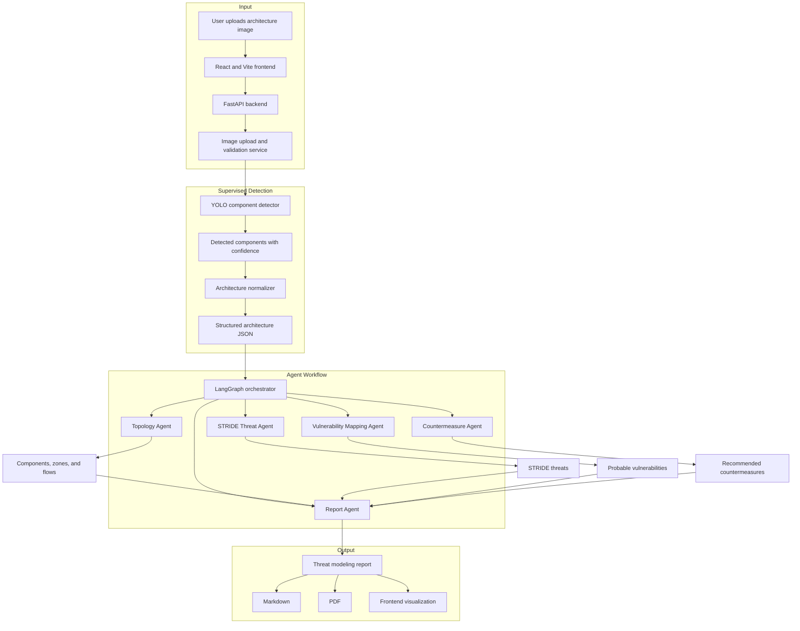

# Architecture

This diagram mirrors the existing Mermaid project flow and shows the intended MVP pipeline.

## Backend Responsibilities

- Receive and validate uploaded diagrams.
- Run the supervised detector when a model artifact is available.
- Store raw uploads, predictions, and generated reports.
- Normalize detections into a typed architecture representation.
- Run threat modeling agents and expose report endpoints.

## Frontend Responsibilities

- Upload architecture diagrams.
- Display detected components and confidence values.
- Allow human review before analysis.
- Render the generated report, risk matrix, and threat tables.
