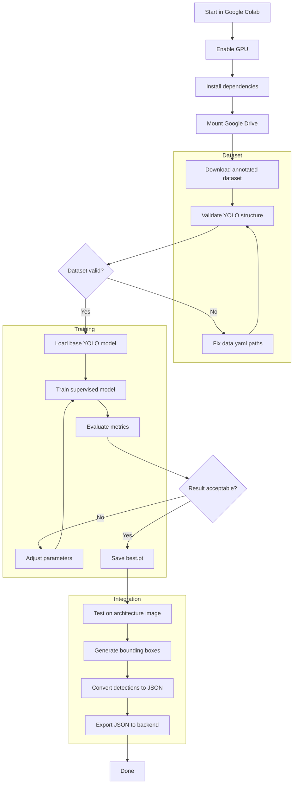

# Training Workflow

The training path follows the existing Mermaid notebook flow and assumes a YOLO-compatible annotated dataset.

## Expected Artifact

The notebook should export:

- `models/best.pt`: trained YOLO weights.
- `models/model_metadata.json`: class names, training date, metrics, and dataset version.
- `examples/output/detected_components.json`: detector output sample for backend testing.
